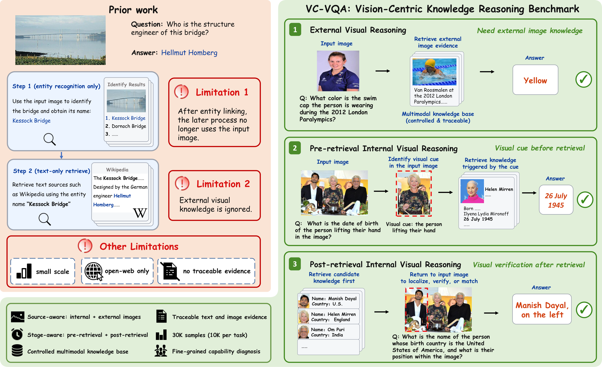

# VC-VQA (Beyond Entity Recognition: Vision-Centric Knowledge Visual Question Answering)

This is the official repository for VC-VQA (EACL 2027 Main).

[](https://arxiv.org/abs/2611.25680v1)
[](https://huggingface.co/datasets/CASIA-IVA-Lab/VC-VQA)

<!-- Replace the arXiv and Hugging Face URLs above once they are available. -->

## 💡 Overview

We introduce VC-VQA, a large-scale benchmark for vision-centric knowledge reasoning. VC-VQA evaluates whether Multimodal Large Language Models can acquire fine-grained visual knowledge and carry out multi-stage reasoning, rather than treating the input image as an entity name that is discarded after linking.

Visual information is organized by its source and by the stage at which it is used. The benchmark defines three tasks, with 10,000 samples each:

*   **External Visual Reasoning**: The answer depends on visual knowledge in an external image. Text alone is not sufficient.
*   **Pre-retrieval Internal Visual Reasoning**: The model must first read a visual cue from the input image, then use that cue to retrieve external knowledge.
*   **Post-retrieval Internal Visual Reasoning**: The model first retrieves candidate knowledge, then returns to the input image to localize, verify, or match it.

Each sample is paired with traceable textual and visual evidence in a controlled multimodal knowledge base built from an English Wikipedia snapshot. We evaluate 21 MLLMs under four settings: no external knowledge, provided evidence, retrieval from the controlled knowledge base, and open-web search. Current models still struggle with vision-centric knowledge reasoning, fine-grained visual knowledge acquisition remains the main bottleneck, and agentic retrieval outperforms heuristic retrieval.

<p align="center">
     <br>
</p>


## 🚀 Get Started

### VC-VQA Dataset

The questions and images can be downloaded here:

*   [Dataset]([https://huggingface.co/datasets/TBD](https://huggingface.co/datasets/CASIA-IVA-Lab/VC-VQA)

VC-VQA contains 30,000 (image, question, answer) samples. The fields are:

*   **question**: The question asked about the input image.

*   **image_url**: The URL of the input image.

*   **image**: The input image, stored as bytes in the Parquet file.

*   **answer**: The ground-truth answer.

*   **original_question**: The question before it is rewritten with the scene of the evidence image. For external visual reasoning, this is the question that directly asks about a visual attribute of the evidence image.

*   **evidence_image_url**: The URL of the gold external evidence image.

*   **evidence_image**: The gold evidence image, stored as bytes in the Parquet file.

*   **evidence_image_caption**: The caption of the evidence image.

*   **evidence_url**: The Wikipedia page from which the evidence is taken.

*   **evidence_title**: The title of the Wikipedia page in `evidence_url`.

### Controlled Knowledge Base

Our knowledge base is based on EVQA's, which can be downloaded here:

*   [Knowledge base](https://github.com/google-research/google-research/tree/master/encyclopedic_vqa#controlled-knowledge-base)

### Running `run.py`

`run.py` queries an OpenAI-compatible server with the input image and question, and writes one prediction per line. Install the dependencies and start the server before running:

```bash
python run.py
```

Set the input Parquet path and the output file at the bottom of `run.py`. The script reads `question`, `image`, and `answer`, and saves records in the following form:

```json
{"question": "Was the person's hair black at the Arvika Festival in 2009?", "predicted_answer": "no", "answer": "no"}
```

### Evaluation with `eval.py`

`eval.py` scores a prediction file with exact match, then uses the same local server as an LLM judge for the remaining cases. Point `data_path` to the JSONL produced by `run.py`. Run evaluation:

```bash
python eval.py
```


## ❤️ Acknowledgement

We would like to thank the following open-source projects for their valuable contributions:

*   [EVQA](https://github.com/google-research/google-research/tree/master/encyclopedic_vqa)
*   [M3VQA](https://github.com/CASIA-IVA-Lab/M3VQA)
*   [VisBrowse-Bench](https://github.com/ZhengboZhang/VisBrowse-Bench)


## 📑 Citation

If you find this work helpful, please cite using this BibTeX:

```bibtex
@article{ma2026beyond,
  title={Beyond Entity Recognition: Vision-Centric Knowledge Visual Question Answering},
  author={Ma, Jiatong and Liu, Yuchen and Guo, Longteng and Yuan, Yichen and Wu, Yuze and Hao, Dongze and Zhen, Ru and Zhang, Yanhao and Lu, Haonan and Liu, Jing},
  journal={arXiv preprint arXiv:2611.25680},
  year={2026}
}

```

## ✉️ Contact

If you have any questions, please reach out to:

*   Jiatong Ma - majiatong2025@ia.ac.cn
